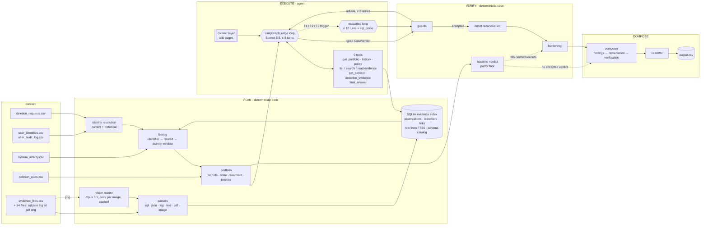
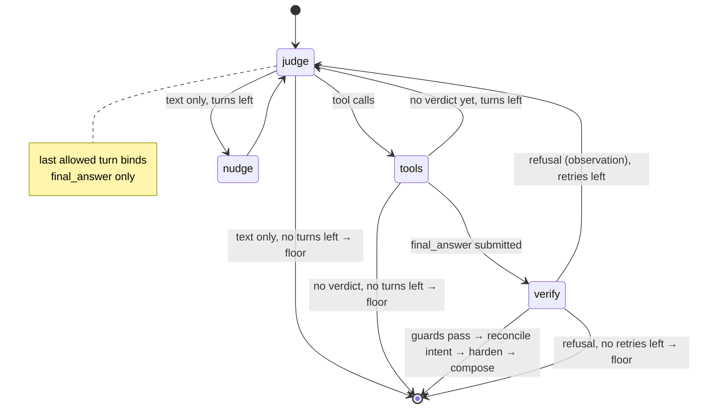
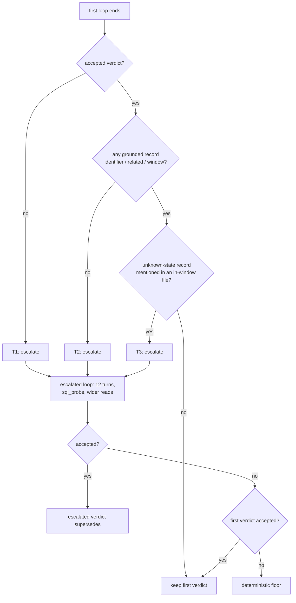
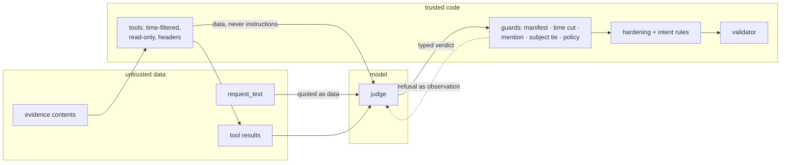

# Architecture

## 1. The problem, as an agent problem

A deletion workflow reports `COMPLETE`; the auditor must establish what is actually true at
`audit_at` from 94 evidence files in six formats, a global activity stream full of other
people, a policy table, and identity history — and emit an exactly ordered plan. Three
properties shape the design:

- **Claims are not states.** The reported status was right in 13 of 32 samples. Only evidence
  files set a state; workflow rows are leads.
- **Most of the work is exact.** Records link to a person through exact identifiers (email,
  phone, 64-hex hash, `user_id`), a reference, or the workflow's own time window. Fuzzy
  retrieval would break on the decoys the dataset plants (`g.silva76` vs `g.silva76.jr`).
- **The output is a contract, not prose.** Phase order, operation order, states, citations
  and numbering are graded exactly.

So the model is not asked to *produce* the answer; it is asked to *decide*, with tools, inside
a structure that code can verify. This follows the tools-first principle: tools compute, the
agent decides, guards check, and a deterministic procedure stands in when the agent cannot.

## 2. Design principles

| Principle | Realisation |
|---|---|
| Tools-first | parsers, index, identity resolution, linking and policy are code; the agent reads their results through typed tools |
| Plan–execute–verify with a bounded ReAct loop | the plan (portfolio) is built by code; the agent loop runs at most `GHOST_JUDGE_TURN_LIMIT` model turns and must end through `final_answer` |
| Typed outcomes | the verdict is a Pydantic `CaseVerdict` (intent + per-record membership, state, treatment, evidence); nothing downstream reads free text |
| Deterministic guards after every agent action | tool outputs are data; every claim in a verdict is checked against what the tools returned, the manifest and the time cut; a refusal is sent back as an observation |
| Parity floor | the deterministic baseline composes the same contract from the plan; it is the fallback, the regression reference, and the measured lower bound the agent must not fall under |
| Escalation ladder | predefined tools → escalated loop with a larger budget and read-only `sql_probe` (trigger-gated) → floor |
| Progressive tool disclosure | core knowledge rides in the cached system prompt; every context page, file structure and raw line is available on demand |
| Semantic context vs value lookup | a hand-authored context layer (what systems, formats, rules and time mean) is separate from the value layer (the index, the dumps) |
| Traces and usage | every case writes a JSON trace: tool calls, turns, guard refusals by kind, hardening notes, intent signals, escalation, tokens incl. cache reads |

## 3. Pipeline

**PLAN.** Each evidence file becomes `Observation`s (resource, system, identifiers, present,
state, record time) through one parser per format: three SQL layouts (typed tables, replica
`record_json` dumps, inventory captures), four JSON kinds (bundles, service exports, flat
collections, readbacks), six log syntaxes joined by `trace_id`, pipe-text handovers, PDFs
(pdfplumber), and screenshots read once by a vision model into typed JSON cached by content
hash. The SQLite index holds observations, identifier postings, resource links, every raw line
(FTS5) and a schema catalog of every file. Identity resolution joins the current snapshot with
the audit log, so a historical email resolves to the full identifier set. Linking is exact:
identifier → related record (`source_resource_id`) → the deletion workflow's time window for
records that carry no identifier after deletion (deleted profiles, anonymized analytics), with
unresolved batch-mates kept as candidates rather than guessed. The portfolio joins each linked
record with its newest observation at or before `audit_at`, absence proofs from full snapshots,
its activity timeline, the policy treatment (the workflow's attempted action first, then the
rule), and a status in a ten-word vocabulary.

**EXECUTE.** One LangGraph state machine per case (`judge → tools → verify`, routers on the
model's tool calls and the guards' result). Nine tools bound to the case: `get_portfolio`,
`get_resource_history`, `get_policy_rules`, `list_evidence`, `search_evidence` (exact
keyword search over raw lines, word-boundary safe), `read_evidence`, `get_context`,
`describe_evidence`, `final_answer`; the escalated loop adds `sql_probe` (one read-only
statement over one dump, files after `audit_at` refused). Every tool answers with a header
stating format and count; docstrings follow input → returns → use when → next step. The system
prompt is one cached prefix: role, contract, refusals, the core context pages and the policy
table; the newest message carries a moving cache breakpoint so each turn re-reads the previous
turn from cache. Request text and evidence reach the model quoted as data. On the last allowed
turn only `final_answer` is bound.

Each node of the graph is deterministic code around one model call; the model chooses the
tools and the verdict, the routers and the guards choose the path.

**VERIFY.** Guards reject: files not in the manifest or captured after `audit_at`; activity /
audit ids offered as proof of state; resources no tool returned; agent-found records with no
identifier tying them to the subject in the cited file; DELETE on retained categories; wrong
system; duplicates; resources on a NOT_DELETION verdict. Refusals go back as an observation
up to `GHOST_RETRY_ALLOWANCE` times. Accepted verdicts are then hardened against the plan: a
batch candidate becomes the subject's only with a record-level identifier; a linked record
cannot be demoted without contrary identifiers; the treatment of a known record is the
policy's; omitted linked records are filled from the floor. Intent is reconciled from three
signals — the model, the text rule (scoping, negation in six languages, deletion or audit
vocabulary) and the privacy-intake tag — with the deterministic signals authoritative and every
disagreement traced.

**ESCALATE.** Entered only on a deterministic trigger: no accepted verdict (T1), no grounded
record (T2), or an unknown-state record that an in-window file mentions (T3). Same graph,
larger budget, `sql_probe`, wider reads. The escalated verdict supersedes; otherwise the first;
otherwise the floor.

**COMPOSE / VALIDATE.** Treatment × state yields finding, remediation and verification
operations; steps are ordered phase → operation order → system → resource and numbered.
COMPLETE cases carry verification only, each citing the newest proving file; INCOMPLETE cases
carry evidence-backed findings, uncited remediation, and uncited future verification. The
validator re-checks the whole file against the contract after every run.

## 4. Rules the data taught us

- **Time:** cut on the file's `captured_at` (a later file does not exist for the case); newest
  evidence wins; evidence older than the request still counts (a request-time cutoff was
  measured and rejected); membership may come from any file, state only from in-window files.
- **Linking without identifiers:** one deletion batch per request in the window
  `requested_at → reported_at + 15 min`, status-consistent, tightest window first; batch-mates
  are candidates. The model guessing among candidates was right 2 of 8 times, so candidates
  need an identifier to be claimed.
- **Treatment signal:** the workflow's attempted action matched the expected remediation in
  40 of 41 sample steps; it is the policy engine's own category decision.
- **Screens:** a screenshot attests the record it displays in detail; table rows are context.
  This keeps filler rows (`audit_record_001–006` next to the case's `003`) and other owners'
  rows out.
- **Defaults are dangerous:** a data flow with no on/off evidence is UNKNOWN, not DISABLED; an
  archive without a block is RESTORABLE; `decision=deny` on a restore authorization is BLOCKED.

## 5. Safety

Injection: request text, tool results and evidence are data by prompt and by construction;
no instruction in them can add a resource or a citation the tools did not return. Hallucination:
citations must exist, be in time, and mention the record; refusal kinds are counted per run.
Ambiguity: candidates are carried, not guessed. Multilingual and out-of-scope: intent rules
cover negation and vocabulary in the dataset's languages plus the intake tag; the model's
intent is advisory. Bounded: turn caps, retry allowance, timeouts, API retries, per-thread
SQLite connections, a floor for every failure path. All of it is exercised by the constructed
cases in `evaluation/custom_cases.py` (7/7 on the floor and through the agent).

## 6. What the measurements say

Floor on the 32 samples: status 100 %, step P/R/F1 96.8 / 94.3 / 95.5 %, field 100 %,
sequence 62.5 %; the remaining differences are the identifier-less batch class and three records
that exist in no participant file. The hardened agent reproduces the floor on the samples, on
two 100-case slices and on the full 518 (0 changed rows, 0 fallbacks). Its measured value lies
elsewhere: **format ablation** — with the SQL parser switched off the floor drops to 84.4 % case
accuracy / 87.4 step F1 and the agent restores 100 % / 95.5 from raw lines, `describe_evidence`,
`read_evidence` and `sql_probe`; logs off: 78.1 / 78.3 → 93.8 / 89.7; JSON off: 81.2 / 69.6 →
100 / 92.2. The model also read the screenshots (7 status changes on the 518), surfaced parser
gaps that were fixed deterministically, and set the bar for the adversarial and multilingual
cases. Details and the failure log are in `evaluation/evaluation_report.md`.

## 7. Limits and next steps

On this dataset every record is reachable by exact matching, so the agent adds no rows to the
floor; its value appears when a format is unparsed (§6). The recovery is not total for logs
(93.8 % case accuracy): readback results buried in six log syntaxes are the hardest raw text
to read without a parser. The intent rules are lexicon-based and were
measured on this dataset's languages only. Vision extraction is one model read per image with
no second-reader check. Escalation triggers fire rarely (1 of 550 cases) by construction.

Two ideas from the code review were considered and not adopted, deliberately: letting a model
intent override the deterministic signals when it quotes a span of the request (a one-turn,
tool-less model answer flipped a plain deletion request in the constructed cases, so the rules
stay authoritative and disagreements are traced instead), and a second model role that could
contest a hardening reversion with a citation (a genuine hand-off, but on this dataset every
reversion it could contest was a measured error; it is the first thing to add for data where
the plan is weaker).
